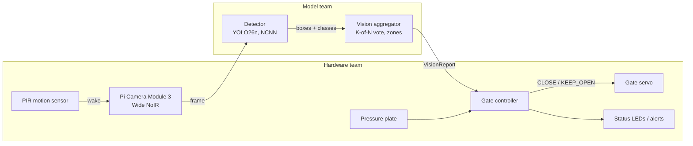

# SCOUT: Smart Cat Observation & Unmanned Trap

An edge-AI add-on for humane live traps used in Trap-Neuter-Return (TNR). A camera and a **Raspberry Pi 3** recognize what enters the trap, and the gate closes only for a cat that is fully inside. Everything runs on the Pi, with no Wi-Fi needed.

**CS 4605 Mobile & Ubiquitous Computing · Fall 2026 · Group 29**
Mentor: Christine Taylor · Model team: Sudiksha Das, Henry Poulin · Hardware team: Keshav Sheth, Sowmiyan Nattamai Vijayakumar

Design docs: [SCOUT - Research/Notes](https://docs.google.com/document/d/1BFhBik9DCZgdWnCy8yDcnWfe-6-JuTAZf1hQFuI_Fq8/edit) (High Level Plan, CV Model, Code Base Guide, CV Team Updates, Hardware Notes tabs). "Plan section N" in code comments means the CV Model tab.

### Success criteria

No live animals are trapped this semester.

| Part | Tested on | Target |
| --- | --- | --- |
| Model accuracy | Held-out public camera-trap pictures from unseen locations | **At least 75%** of cats caught (aiming for 80%), **under 5%** of other animals called cats (as low as possible) |
| Trap trials | Staged with props (stuffed animals, tablet photos) | Gate closes for cat props and stays open for non-cat props, decision < 5 s, never reports "cat in trap" while the cat is in the doorway |
| Compute | The Raspberry Pi 3 itself, no Wi-Fi or outside computing | Vote finishes inside the 5 s limit (aim 2 s), and the model fits in 1 GB of RAM |

Prop footage checks the camera, zones, vote and gate. It is not used to report accuracy.

### Compute limit: Raspberry Pi 3

Every model and setting has to run on the Pi 3. A better score that the Pi 3 can't run in time doesn't count.

- **Time per frame:** a 3-of-5 vote needs at least 3 frames, so one frame, camera included, must take under about 1.6 s to meet the 5 s limit, or 0.67 s to meet the 2 s aim.
- **Memory:** the model and its software have to fit in 1 GB of RAM.
- **Not measured yet:** we have no Pi 3 numbers. `edge/bench.py` sets the model, the picture size and the real frame rate.

## Status (Oct 30)

- **Model:** best run is **E1b**, with **69.2%** of cats caught and **4.8%** false positives (cutoff 0.25, at 640 pixels). False positives meet the goal, but cats caught are 5.8 points short. It finds an animal in 92% of cat pictures, and most of its misses are wrong labels. These scores aren't at the trap's 416 pixels yet.
- **Hardware:** the tabletop prototype is built. Next is programming the Pi 3 and setting it up on the trap. No Pi 3 speed number yet.
- **Gate decision:** the gate stays open while armed and closes only when the camera reports a cat in the trap **and** the pressure plate is pressed.

Experiment results, the improvement plan and how runs are evaluated are in the **[CV model update](docs/CV_MODEL_UPDATE.md)**.

## How it works



1. **Wake:** the PIR sensor detects motion and the camera starts. The frame rate is whatever the Pi 3 can sustain (at most 5 fps; not measured yet).
2. **Detect:** YOLO labels each animal as cat, raccoon, opossum, squirrel, dog, other animal or person.
3. **Vote:** a cat counts as "in trap" only if it is in the trap zone in 3 of the last 5 frames. If one box gets two labels, only the clearly stronger one counts.
4. **Decide:** the gate controller combines the vision report, the pressure plate and its safety rules (non-cat cooldown, doorway check, faults).

Vote, cutoffs and zones are set in `edge/vision_config.json`.

### Who owns what

The model team **reports observations**; the hardware team **decides actions**.

| Decision | Owner | Where |
| --- | --- | --- |
| Animal class and box | Model | `edge/vision.py` `Detector` |
| Cat really in trap? Doorway? Non-cat? | Model | `edge/vision.py` `VisionAggregator` |
| Trap and doorway zones | Both | `edge/vision_config.json` (`edge/draw_zones.py`) |
| Close the gate now? | Hardware | `edge/gate.py` `GateController` |
| Servo, LEDs, PIR, plate, power | Hardware | `edge/run_trap.py` |

### Interface

```python
from edge.vision import Detector, VisionAggregator
from edge.gate import GateController, Command

detector = Detector("best_ncnn_model", imgsz=416)
vision = VisionAggregator.from_config()
gate = GateController(require_plate=True)
gate.arm()

report = vision.update(detector.detect(frame))    # model team
status = gate.tick(report, plate_pressed=plate_pressed())   # hardware team
if status.command == Command.CLOSE:
    close_gate()
```

`VisionReport` fields: `cat_in_trap`, `cat_confidence`, `cat_hits`, `animal_in_doorway`, `non_cat`, `non_cat_confidence`, `cat_box`, `n_detections`, `timestamp`.

### Test without a model

`edge/stub.py` sends fake detections through the real vision and gate code. Each token is one frame: `c` cat in trap, `d` cat in doorway, `r` raccoon, `o` opossum, `n` nothing, `f` fault, `p` cat with plate pressed.

```bash
python -m edge.stub --script c,c,c,c,c            # closes on frame 3
python -m edge.stub --script c,c,r,c,c            # raccoon -> cooldown, stays open
python -m edge.stub --script c,c,c,c,p --plate    # closes only when plate pressed
python -m edge.stub --interactive
python -m edge.stub --trials 50                   # 50 random scored trials
```

## Code map

```
data/        dataset tools (PACE)
  common.py, fetch_metadata.py, stats.py   class list, LILA metadata, counts
  splits.py, splits.json                   location-based splits (committed, do not change)
  build_manifest.py, download_images.py    balanced image list, YOLO labels
  validate_dataset.py                      label checks
  build_seen_split.py                      seen-location test split
  make_train_list.py                       cat oversampling, extra footage
  make_grayscale.py                        grayscale training copies (E4)
  add_wellington.py                        Wellington data and a new eval set (E7)
  manifest_report.py                       cats per split, camera, time of day and size
  backyard_labels.csv                      animal and rotation for each video in backyard_camera/ (videos aren't in git)
  add_trap_footage.py                      import labeled prop footage
  video_to_frames.py                       real-animal videos to clip folders and a labeling pool
training/    training and evaluation (PACE)
  train_yolo.py                            train a detector run
  eval.py                                  recall, per-species FPR, threshold sweep
  score_pipeline.py                        scores the trap's rules, saves detections
  train_crop_classifier.py                 E8 crop check
  curve.py                                 best epoch, still improving?
  analyze_errors.py                        why cats are missed
  vote_sim.py                              choose cutoff + K-of-N vote; replay gate on clips
  train_classifier.py                      E2 MobileNetV3 comparison
  slurm/                                   PACE jobs
edge/        runs on the Pi
  vision.py, vision_config.json            detector, aggregator, settings
  gate.py, run_trap.py                     gate controller, main loop + hardware hooks
  stub.py, bench.py                        fake detections, Pi latency
  demo.py, draw_zones.py                   laptop demo/recorder, zone drawing
tests/       python -m pytest tests
docs/        CV model update
results/     one folder per run (metrics kept, weights git-ignored)
```

## Running experiments on PACE ICE

Training and scoring run on PACE, where the data and GPUs are. Always submit jobs with `sbatch`, not on the login node. The plan and how runs are compared are in the [CV model update](docs/CV_MODEL_UPDATE.md).

**1. Set up once**:

```bash
git clone https://github.com/sudikshadas1/scout.git && cd scout
bash training/slurm/setup_env.sh
sbatch training/slurm/smoke_test.sbatch        # checks the GPU
sbatch training/slurm/data.sbatch              # labels, picture list, downloads
sbatch training/slurm/run.sbatch python data/validate_dataset.py   # after the data job finishes
sed "s#~/scratch#$HOME/scratch#" data/scout.yaml > data/scout_pace.yaml   # not in git; training reads it
```

**2. Get the latest code:**

```bash
ssh <gt-username>@login-ice.pace.gatech.edu    # on the GT VPN if off campus
cd ~/scout && git pull
```

**3. Submit a run.** Run the first two rows in order. Each job's output goes to `logs/`.

| Run | What it does | Command |
| --- | --- | --- |
| Wellington data | Downloads the E7 data and new eval set | `sbatch training/slurm/e7_data.sbatch` |
| Score E1b | E1b at the trap's 416 pixels | `sbatch training/slurm/eval_pace.sbatch E1b 500 416` |
| E7 | Adds Wellington data | `sbatch --time=14:00:00 -J scout-E7 training/slurm/train_pace.sbatch E7 --epochs 80 --patience 25 --data-yaml ~/scratch/scout_data/scout_e7.yaml` |
| E8 | Crop check, using E1b's scores | `sbatch training/slurm/e8_crop.sbatch` |
| E9 | Higher classification loss | `sbatch -J scout-E9 training/slurm/train_pace.sbatch E9 --cls 1.0 --epochs 80 --patience 25` |
| E3 | Bigger model, if the Pi 3 speed test allows | `sbatch -J scout-E3 training/slurm/train_pace.sbatch E3 --weights yolo26s.pt --epochs 80 --patience 25` |
| E4 | Black-and-white training (make the copies first) | `sbatch training/slurm/run.sbatch python data/make_grayscale.py --data ~/scratch/scout_data`, then `sbatch -J scout-E4 training/slurm/train_pace.sbatch E4 --epochs 80 --patience 25 --data-yaml ~/scratch/scout_data/scout_gray.yaml` |
| E10 | Training at 416, if E1b drops at 416 | `sbatch -J scout-E10 training/slurm/train_pace.sbatch E10 --imgsz 416 --epochs 80 --patience 25` |

E7 is estimated at about 11 hours, and training jobs default to 8. Training can't resume after a time-out, so if PACE refuses the longer time, use `--epochs 50`.

**4. Score every finished detector run** the same way. E8 scores itself.

```bash
sbatch training/slurm/eval_pace.sbatch <run> 500 416
```

This writes `results/<run>_eval416`, `_analysis416` and `_pipeline416`, plus `_wct416` once the Wellington data exists.

**5. Check on jobs and bring results back.** PACE has no GitHub login, so commit from a laptop. Weights stay on PACE.

```bash
squeue -u $USER                                # on PACE
tail -f logs/<job-name>-<job-id>.out           # on PACE
scp -r <gt-username>@login-ice.pace.gatech.edu:~/scout/results/<folder> results/   # on your laptop
```

Past runs are kept as they were run: `e0.sbatch`, `e1_*.sbatch`, `e1b_eval.sbatch`, `e1c_eval.sbatch`, `e2.sbatch` and `seen.sbatch`. The seen-location score is a reported limitation, because no unseen cat pictures remain at the training cameras.

## Setting up the Pi 3 (hardware team)

Install 64-bit Raspberry Pi OS first, because Ultralytics needs it. The CV team gives you `best_ncnn_model`, converted on a laptop or PACE, not on the Pi 3.

```bash
python3 -m venv --system-site-packages .venv && source .venv/bin/activate
pip install -r requirements-pi.txt
python -m edge.stub --interactive
python -m edge.bench --model best_ncnn_model --imgsz 416 --runs 200   # E6; try --imgsz 320 if too slow
python -m edge.run_trap --model best_ncnn_model --plate
```
