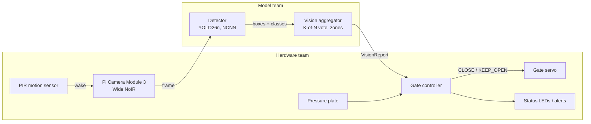

# SCOUT: Smart Cat Observation & Unmanned Trap

An edge-AI add-on for humane live traps used in Trap-Neuter-Return (TNR). A camera and a **Raspberry Pi 3** recognize what enters the trap, and the gate closes only for a cat that is fully inside. Everything runs on the Pi, with no Wi-Fi needed.

**CS 4605 Mobile & Ubiquitous Computing · Fall 2026 · Group 29**
Mentor: Christine Taylor · Model team: Sudiksha Das, Henry Poulin · Hardware team: Keshav Sheth, Sowmiyan Nattamai Vijayakumar

Design docs: [SCOUT - Research/Notes](https://docs.google.com/document/d/1BFhBik9DCZgdWnCy8yDcnWfe-6-JuTAZf1hQFuI_Fq8/edit) (High Level Plan, CV Model, Code Base Guide, CV Team Updates, Hardware Notes tabs). "Plan section N" in code comments means the CV Model tab.

### Success criteria

No live animals are trapped this semester.

| Part | Tested on | Target |
| --- | --- | --- |
| Model accuracy | Held-out public camera-trap pictures from unseen locations | **At least 75%** of cats caught (aiming for 80%), **under 5%** of other animals called cats (as low as possible) |
| Trap trials | Staged with props (stuffed animals, tablet photos) | Gate closes for cat props and stays open for non-cat props, decision < 5 s, never reports "cat in trap" while the cat is in the doorway |
| Compute | The Raspberry Pi 3 itself, no Wi-Fi or outside computing | Vote finishes inside the 5 s limit (aim 2 s), and the model fits in 1 GB of RAM |

Prop footage checks the camera, zones, vote and gate. It is not used to report accuracy.

### Compute limit: Raspberry Pi 3

Every model and setting has to run on the Pi 3. A better score that the Pi 3 can't run in time doesn't count.

- **Time per frame:** a 3-of-5 vote needs at least 3 frames, so one frame, camera included, must take under about 1.6 s to meet the 5 s limit, or 0.67 s to meet the 2 s aim.
- **Memory:** the model and its software have to fit in 1 GB of RAM.
- **Not measured yet:** we have no Pi 3 numbers. `edge/bench.py` sets the model, the picture size and the real frame rate.

## Status (Oct 30)

- **Model:** best run is **E1b**, with **69.2%** cat recall and **4.8%** false positives. False positives meet the goal, but recall is 5.8 points short. The model finds 92% of cats but mislabels most of the ones it misses.
- **Hardware:** the tabletop prototype is built. Next is programming the Pi 3 and setting it up on the trap. No Pi 3 speed number yet.
- **Gate decision:** the gate stays open while armed and closes only when the camera reports a cat in the trap **and** the pressure plate is pressed.

## How it works



1. **Wake:** the PIR sensor detects motion and the camera starts. The frame rate is whatever the Pi 3 can sustain (at most 5 fps; not measured yet).
2. **Detect:** YOLO labels each animal as cat, raccoon, opossum, squirrel, dog, other animal or person.
3. **Vote:** a cat counts as "in trap" only if it is in the trap zone in 3 of the last 5 frames. If one box gets two labels, only the clearly stronger one counts.
4. **Decide:** the gate controller combines the vision report, the pressure plate and its safety rules (non-cat cooldown, doorway check, faults).

Vote, cutoffs and zones are set in `edge/vision_config.json`.

### Who owns what

The model team **reports observations**; the hardware team **decides actions**.

| Decision | Owner | Where |
| --- | --- | --- |
| Animal class and box | Model | `edge/vision.py` `Detector` |
| Cat really in trap? Doorway? Non-cat? | Model | `edge/vision.py` `VisionAggregator` |
| Trap and doorway zones | Both | `edge/vision_config.json` (`edge/draw_zones.py`) |
| Close the gate now? | Hardware | `edge/gate.py` `GateController` |
| Servo, LEDs, PIR, plate, power | Hardware | `edge/run_trap.py` |

### Interface

```python
from edge.vision import Detector, VisionAggregator
from edge.gate import GateController, Command

detector = Detector("best_ncnn_model", imgsz=416)
vision = VisionAggregator.from_config()
gate = GateController(require_plate=True)
gate.arm()

report = vision.update(detector.detect(frame))    # model team
status = gate.tick(report, plate_pressed=plate_pressed())   # hardware team
if status.command == Command.CLOSE:
    close_gate()
```

`VisionReport` fields: `cat_in_trap`, `cat_confidence`, `cat_hits`, `animal_in_doorway`, `non_cat`, `non_cat_confidence`, `cat_box`, `n_detections`, `timestamp`.

### Test without a model

`edge/stub.py` sends fake detections through the real vision and gate code. Each token is one frame: `c` cat in trap, `d` cat in doorway, `r` raccoon, `o` opossum, `n` nothing, `f` fault, `p` cat with plate pressed.

```bash
python -m edge.stub --script c,c,c,c,c            # closes on frame 3
python -m edge.stub --script c,c,r,c,c            # raccoon -> cooldown, stays open
python -m edge.stub --script c,c,c,c,p --plate    # closes only when plate pressed
python -m edge.stub --interactive
python -m edge.stub --trials 50                   # 50 random scored trials
```

## Code map

```
data/        dataset tools (PACE)
  common.py, fetch_metadata.py, stats.py   class list, LILA metadata, counts
  splits.py, splits.json                   location-based splits (committed, do not change)
  build_manifest.py, download_images.py    balanced image list, YOLO labels
  validate_dataset.py                      label checks
  build_seen_split.py                      seen-location test split
  make_train_list.py                       cat oversampling, extra footage
  make_grayscale.py                        grayscale training copies (E4)
  backyard_labels.csv                      animal and rotation for the videos in backyard_camera/ (git-ignored)
  add_trap_footage.py                      import labeled prop footage
  video_to_frames.py                       real-animal videos to clip folders and a labeling pool
training/    training and evaluation (PACE)
  train_yolo.py                            train a detector run
  eval.py                                  recall, per-species FPR, threshold sweep
  analyze_errors.py                        why cats are missed
  vote_sim.py                              choose cutoff + K-of-N vote; replay gate on clips
  train_classifier.py                      E2 MobileNetV3 comparison
  slurm/                                   PACE jobs
edge/        runs on the Pi
  vision.py, vision_config.json            detector, aggregator, settings
  gate.py, run_trap.py                     gate controller, main loop + hardware hooks
  stub.py, bench.py                        fake detections, Pi latency
  demo.py, draw_zones.py                   laptop demo/recorder, zone drawing
tests/       python -m pytest tests
results/     one folder per run (metrics kept, weights git-ignored)
```

| PACE job (`training/slurm/`) | Runs |
| --- | --- |
| `setup_env.sh`, `smoke_test.sbatch` | conda setup, GPU check |
| `data.sbatch` | metadata, manifest, image download |
| `e0.sbatch`, `e1_*.sbatch`, `e1b_eval.sbatch`, `e1c_eval.sbatch` | past runs, as run |
| `train_pace.sbatch <name> [args]` | any new detector run |
| `eval_pace.sbatch <name> [n] [imgsz]` | eval + miss analysis + vote estimate |
| `seen.sbatch <name>` | seen-location score |
| `e2.sbatch` | E2 classifier |

Jobs read `data/scout_pace.yaml`, which exists only on PACE (`~/scout/data/`) and is not in git.

## Getting started

**Model team (PACE ICE).** Already set up; repeat only on a new account.

```bash
git clone https://github.com/sudikshadas1/scout.git && cd scout
bash training/slurm/setup_env.sh
sbatch training/slurm/smoke_test.sbatch
export DATA=~/scratch/scout_data
python data/fetch_metadata.py --out $DATA
sbatch training/slurm/data.sbatch
python data/validate_dataset.py
```

**Hardware team (Pi 3).**

```bash
python3 -m venv --system-site-packages .venv && source .venv/bin/activate
pip install -r requirements-pi.txt
python -m edge.stub --interactive
# install 64-bit Raspberry Pi OS first (Ultralytics needs it)
# best_ncnn_model comes from the CV team: convert on a laptop or PACE, not on the Pi 3
python -m edge.bench --model best_ncnn_model --imgsz 416 --runs 200   # E6; try --imgsz 320 if too slow
python -m edge.run_trap --model best_ncnn_model --plate
```

## CV results

Validation: 500 pictures (208 cats, 292 non-cats) from camera locations never used in training, scored at 640 pixels. The trap runs at 416 pixels, which hasn't been scored yet. Each cell is cat recall / false positives.

| Run | Change | Cutoff 0.05 | Cutoff 0.15 (trap now) | Cutoff 0.25 |
| --- | --- | --- | --- | --- |
| E0 | Stock YOLO26n | 5.3% / 5.1% | 4.8% / 2.7% | 4.3% / 2.1% |
| E1 | Fine-tuned on Caltech + ENA24, 24 epochs | 63.5% / 4.5% | 59.6% / 2.4% | 54.8% / 2.1% |
| **E1b** | **E1, 80 epochs** | **73.1% / 9.9%** | **71.2% / 6.5%** | **69.2% / 4.8%** |
| E1c | E1b + cat images repeated 2× | 70.7% / 6.8% | 69.7% / 5.8% | 68.8% / 5.1% |
| E2 | MobileNetV3 classifier | 27.9% / 6.2% | 22.6% / 3.8% | 18.8% / 3.1% |

Planned: **E3** bigger model (YOLO26s), **E4** black-and-white training, **E5** prop footage from our trap, **E6** speed test on the Pi 3.

**What E1b's misses show (cutoff 0.25):**
- 47 of 64 missed cats were found but given the wrong label: other animal 18, raccoon 11, opossum 10, dog 5, squirrel 3.
- Small and tiny cats are missed most. **The set has no large cats**, and those are what our close-range trap camera should mostly see, so close-range recall is unmeasured.
- Only 6 of 22 daytime cats were caught, against 74% at night. The sample is small, but matching night recall would add about 10 cats, or most of the 12 needed for 75%.
- Recall ranges from 56% to 79% across the 3 cat locations, which is more than most experiments moved it.
- Most false positives come from `other_animal`, which is called a cat 12.9% of the time (9 of 70). Raccoon is 4.4%, opossum 3.0%, and dog, squirrel and empty images are 0%. Even the stock model E0 calls 8.6% of `other_animal` cats, so some of these may be true look-alikes.
- Repeating cats (E1c) only moved errors around: false positives on opossums went from 2 to 8, and missed cats called `other_animal` from 18 to 26.

**Settings.**
- The trap acts on a 3-of-5 vote at a 0.15 cutoff, not on single frames. Re-measure this on real and staged clips with `vote_sim.py clips`.
- If one box gets two labels, the weaker one is dropped only when it trails by at least 0.1 confidence. Close calls keep both, so the gate stays open.

## Reaching the goals

| | Goal | E1b today (cutoff 0.25) | Gap on the 500-picture set |
| --- | --- | --- | --- |
| Cats caught | at least 75% (aiming for 80%) | 69.2% (144 of 208) | 12 more cats for 75%, 23 more for 80% |
| False positives | under 5%, as low as possible | 4.8% (14 of 292) | no room: 15 false positives is over 5% |

**Changing the cutoff can't close this gap.** Lowering E1b's cutoff trades false positives for recall: 0.15 gives 71.2% recall and 6.5% FPR, and 0.05 gives 73.1% and 9.9%. Under 5%, the most E1b reaches is 69.2%. The model itself has to tell cats from other animals better, so the 47 mislabeled cats are the main target.

**Decision rule:** keep the model that reaches at least 75% of cats with under 5% false positives at 416 pixels and fits the time budget on the Pi 3. That model goes into E5 and is frozen by Nov 16.

## Next steps

**Plan to improve the model, in order** (from the CV Team Updates tab):

1. **Re-score E1b at the Pi's picture size.** The trap runs at 416 pixels, but every score above is at 640. If the numbers drop, that is the real starting point.
   ```bash
   sbatch training/slurm/eval_pace.sbatch E1b 500 416     # results/E1b_eval416, E1b_analysis416
   ```
2. **Re-tune the cutoff and vote** for under 5% false positives (no training needed). `vote_sim.py` applies the limit to the single-frame rate, because its trap estimate assumes independent frames and comes out far too low. Then update `edge/vision_config.json`.
   ```bash
   python training/vote_sim.py sweep results/E1b_eval416/threshold_sweep.csv
   ```
3. **Look at the "other animal" mistakes** in the contact sheets in `results/E1b_analysis/` (on PACE). If they are bobcats, that is a true look-alike; E3 and E5 are the fixes.
4. **E3: a bigger model (YOLO26s).** Same data and settings as E1b; only the model size changes. It's only usable if fast enough on the Pi 3, so time it with `edge/bench.py` (E6). The training job has an 8-hour limit; if it stops early, lower `--epochs` or ask for more time.
   ```bash
   sbatch -J scout-E3 training/slurm/train_pace.sbatch E3 --weights yolo26s.pt --epochs 80 --patience 25
   sbatch training/slurm/eval_pace.sbatch E3 500 416
   ```
5. **E4: black-and-white training.** The NoIR camera washes out colour, and daytime cats are the weakest group.
   ```bash
   python data/make_grayscale.py --data ~/scratch/scout_data
   sbatch -J scout-E4 training/slurm/train_pace.sbatch E4 --epochs 80 --patience 25 \
          --data-yaml ~/scratch/scout_data/scout_gray.yaml
   sbatch training/slurm/eval_pace.sbatch E4 500 416
   ```
6. **Real-animal videos: use them as a test set first** (see below). They show cats up close, so also label a frame pool in Roboflow and add whole videos to training, keeping other videos for testing.
7. **Once the camera is on the trap:** footage pilot, prop labeling round 1, then E5 (prop footage, starting from the better of E1b and E3).

**Hand-off and E6:** export the model to NCNN on a laptop or PACE, not on the Pi 3, and give the hardware team the model folder and `edge/vision_config.json`. The Pi 3 speed number decides the picture size and whether E3 fits.

```bash
python -m edge.bench --model best.pt --export ncnn --imgsz 416                  # laptop or PACE
python -m edge.bench --model best_ncnn_model --imgsz 416 --runs 200             # on the Pi 3 (E6)
```

**Ideas not in the plan yet** (add to the doc and number them before running): a higher classification loss (`--cls 1.0`), training at 416 pixels if step 1 shows a drop, oversampling the images E1b gets wrong, and scoring the best model on the full val split (8,211 pictures). On 208 cats, recall is only good to about ±6 points.

**Real-animal videos**

`backyard_camera/` holds 46 videos from one Wyze camera (Oct 22–29), about 16 minutes in total. They aren't in git. `data/backyard_labels.csv` lists the animal in each and how to rotate the 8 sideways ones. The labels come from looking at sample frames, so check them before reporting numbers, especially the rows marked "check" and the one `unknown`.

| | Videos | When |
| --- | --- | --- |
| Cat | 25 | 23 in daylight or dusk, 2 in the dark |
| Raccoon | 9 | dusk to dawn |
| Opossum | 11 | dusk to dawn |
| Unknown | 1 | dark |

- **What they add:** daytime cats (E1b caught only 6 of 22) and cats that fill the frame (the 500-picture set has none). They also have real motion and a low camera angle, so they test the vote and gate on real animals.
- **Limits:** it's one yard with only a few different cats, so scores from it don't replace the public pictures. Cats are mostly in daylight and raccoons and opossums almost all in the dark, and there are no daytime non-cats. **If trained on as they are, the model could learn "daylight = cat".** Night footage is in colour, unlike our NoIR camera under infrared. Every frame has a Wyze logo and timestamp, so crop or mask them if training on these frames.

```bash
python data/video_to_frames.py --videos backyard_camera --labels data/backyard_labels.csv --clips-out real/clips --fps 5
python training/vote_sim.py clips --model results/E1b/weights/best.pt --clips real/clips --full-frame --imgsz 416
# after E6: repeat with the Pi 3's measured frame rate (--fps on both commands)
# labeling pool: one frame per second, pre-labeled by E1b, for Roboflow
python data/video_to_frames.py --videos backyard_camera --labels data/backyard_labels.csv \
       --pool-out real/pool --pool-every 1 --prelabel results/E1b/weights/best.pt
```

Never put frames of one video in both training and test.

**Staged footage and E5**

```bash
python -m edge.demo --model best.pt --source 0 --save-dir pilot/clips/cat_01      # r to record
python training/vote_sim.py clips --model best.pt --clips pilot/clips --full-frame
python data/add_trap_footage.py --data ~/scratch/scout_data --export session1_yolo --session s1_day --split train
python data/make_train_list.py --data ~/scratch/scout_data --cat-repeat 2 \
       --extra-dir ~/scratch/scout_data/trap/yolo/images/train --extra-repeat 3 --tag e5
sbatch -J scout-E5 training/slurm/train_pace.sbatch E5 --weights results/E1b/weights/best.pt --epochs 40 \
       --data-yaml ~/scratch/scout_data/scout_e5.yaml
python -m edge.draw_zones --image pilot/clips/empty_01/<frame>.jpg               # once camera is mounted
```

**Laptop demo**

```bash
python -m edge.demo --model results/E1b/weights/best.pt --source 0        # webcam
python -m edge.demo --model best.pt --source demo_pics/ --out demo_out/   # folder of pictures
```

Keys: `q` quit · `space` pause · `s` save frame · `r` record · `a` re-arm · `z` zones

## Project phases

| Phase | Dates | Goal | Status |
| --- | --- | --- | --- |
| 1. Get set up | to Oct 23 (CP1) | Data split, E0, demo, Pi speed, servo from stub | Data, E0, demo done; the rest moved to 2b |
| 2a. Public data and recording round 1 | to Oct 31 | E1, E1b, E1c, E2; ~750 labeled prop pictures | Runs done; prop recording moved to 2b |
| 2b. Fine-tune, then fix what fails | Nov 2 – 13 (CP2) | E1b running on the Pi 3 in the trap, closing the gate on the bench; E3, E4, E5, E6 | |
| 3. Test and freeze | freeze by Nov 16; CP3 Nov 24 | Final numbers; 50+ staged prop trials | |
| 4. Demo | Dec 2 – 8 | Model labels brand-new pictures live; trap closes for a cat prop and stays open for other props | |

### Open items

- [ ] Add all team members as GitHub collaborators
- [ ] Footage pilot in the real trap (stuffed cat, tablet photos, empty trap)
- [ ] E6: Pi 3 speed test (`python -m edge.bench`)
- [ ] Camera cable: the Pi 5 cable on the materials list doesn't fit a Pi 3
- [ ] Decide whether the servo and plate run on the Pi or a separate board
- [ ] Close the servo from `python -m edge.stub`
- [ ] Camera position, IR light, pressure plate decision
- [ ] Pick a labeling tool and record round 1

### Learning cats, not backgrounds

- Test images always come from unseen camera locations.
- About 10% of training images are empty, and near-duplicate burst photos are limited.
- Every staged session includes cat props, non-cat props and an empty trap.
- E5 is always re-scored on real-animal test pictures.

### Code status

| State | Code |
| --- | --- |
| Run on real data | data pipeline, E0, E1, E1b, E1c, E2, miss analysis |
| Tested on laptop | vision/gate interface, stub, demo, zone tool, Pi benchmark, main loop, video frames, grayscale copies |
| To write | second-camera support |
| Placeholder | trap and doorway zones, until the camera is mounted |

Each file starts with a header covering its purpose, status and remaining work.
