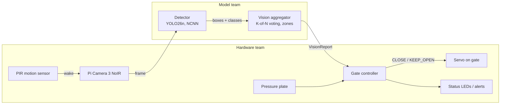

# SCOUT: Smart Cat Observation & Unmanned Trap

An edge-AI add-on for humane live traps used in Trap-Neuter-Return (TNR). A camera and a Raspberry Pi 5 recognize what walks into the trap, and the gate closes only for a cat that is fully inside.

CS 4605 Mobile & Ubiquitous Computing, Fall 2026, Group 29. Mentor: Christine Taylor.
Team: Sudiksha Das and Henry Poulin (model), Keshav Sheth and Sowmiyan Nattamai Vijayakumar (hardware).

Design docs: [SCOUT - Research/Notes](https://docs.google.com/document/d/1BFhBik9DCZgdWnCy8yDcnWfe-6-JuTAZf1hQFuI_Fq8/edit) (CV Model tab: the plan; Code Base tab: how this code maps to it).

## How it works



1. The PIR sensor wakes the system when something moves.
2. The camera captures frames at about 5 fps.
3. The **detector** (fine-tuned YOLO26n) finds animals in each frame: cat, raccoon, opossum, squirrel, dog, other animal, person.
4. The **vision aggregator** smooths those detections over the last 5 frames and reports what it sees: is a cat inside the trap zone (in 4 of the last 5 frames)? Is anything in the doorway? Is a non-cat present?
5. The **gate controller** decides whether to close, using the vision report plus the pressure plate and its safety rules.

Everything runs on the Pi, with no Wi-Fi needed.

## Who decides what

| Question | Decided by | Where |
| --- | --- | --- |
| What animal is this, and where is its box? | Model team | `edge/vision.py` `Detector` |
| Is a cat really in the trap zone (not a one-frame glitch)? | Model team | `edge/vision.py` `VisionAggregator` (K, N, thresholds) |
| Is anything in the doorway? Is a non-cat present? | Model team (reports it) | `VisionReport` |
| Where the trap and doorway zones are in the image | Both, once the camera is mounted | `edge/vision_config.json` |
| Should the gate close now? | Hardware team | `edge/gate.py` `GateController` |
| Pressure plate, cooldown after a non-cat, stay closed until reset, fault handling | Hardware team | `edge/gate.py` |
| Servo, LEDs, PIR wiring, power, alerts | Hardware team | hardware hooks in `edge/run_trap.py` |

The model team **reports observations**; the hardware team **decides actions**. `gate.py` is a reference version written so both sides can test today; the hardware team owns and can change it.

## The interface

```python
from edge.vision import Detector, VisionAggregator
from edge.gate import GateController, Command

detector = Detector("best_ncnn_model", imgsz=416)
vision = VisionAggregator.from_config()       # edge/vision_config.json
gate = GateController(require_plate=False)
gate.arm()

report = vision.update(detector.detect(frame))   # model team
status = gate.tick(report, plate_pressed=False)  # hardware team
if status.command == Command.CLOSE:
    close_gate()
```

`VisionReport` fields: `cat_in_trap`, `cat_confidence`, `cat_hits`, `animal_in_doorway`, `non_cat`, `non_cat_confidence`, `cat_box`, `n_detections`, `timestamp`.

### Test the hardware without a model

`edge/stub.py` feeds fake detections through the real vision and gate code. One token per frame: `c` cat in trap, `d` cat in doorway, `r` raccoon, `o` opossum, `n` nothing, `f` fault, `p` cat + plate pressed.

```bash
python -m edge.stub --script c,c,c,c,c            # closes on frame 4
python -m edge.stub --script c,c,r,c,c            # raccoon: cooldown, stays open
python -m edge.stub --script c,c,c,c,p --plate    # closes only when the plate is pressed
python -m edge.stub --interactive
python -m edge.stub --trials 50                   # random staged trials, scored
```

## Repo layout

```
data/                  dataset tools (model team, run on PACE ICE)
  fetch_metadata.py      download LILA metadata JSONs only (~50 MB)
  stats.py               images per species and per class, per dataset
  splits.py              location-based train/val/test -> data/splits.json (commit it)
  build_manifest.py      choose balanced images + boxes -> manifest.jsonl
  download_images.py     download images, write YOLO labels
  common.py              class list, species -> class mapping
  scout.yaml             Ultralytics dataset config
training/              (model team)
  train_yolo.py          train one experiment (E1, E3, E5 ...)
  eval.py                cat recall, per-species false positives, threshold sweep
  slurm/                 PACE ICE jobs: setup_env.sh, smoke_test, data, train
edge/                  code that runs on the Pi
  vision.py              Detector + VisionAggregator + VisionReport (model team)
  vision_config.json     N, K, thresholds, trap/doorway zones
  gate.py                GateController (hardware team)
  run_trap.py            main loop + hardware hooks (PIR, plate, servo)
  stub.py                fake detections for hardware testing
  bench.py               per-stage latency on the Pi
tests/                 python -m pytest tests
results/               one folder per experiment (metrics kept, weights git-ignored)
```

## Getting started

### Model team, on PACE ICE

```bash
git clone https://github.com/sudikshadas1/scout.git && cd scout
bash training/slurm/setup_env.sh                 # conda env "scout"
sbatch training/slurm/smoke_test.sbatch          # proves the GPU works
export DATA=~/scratch/scout_data
python data/fetch_metadata.py --out $DATA
python data/stats.py --data $DATA                # real species counts
python data/splits.py --data $DATA               # then commit data/splits.json
sbatch training/slurm/data.sbatch                # manifest + image download
python training/eval.py --model yolo26n.pt --data $DATA --split val --n 500 --name E0
sbatch training/slurm/train.sbatch E1
```

### Hardware team, on the Pi 5

```bash
python3 -m venv --system-site-packages .venv && source .venv/bin/activate   # keeps picamera2
pip install -r requirements-pi.txt
python -m edge.stub --interactive
python -m edge.bench --model yolo26n.pt --export ncnn --imgsz 416 --runs 200
python -m edge.run_trap --model yolo26n_ncnn_model
```

## Project phases

The project runs in phases, each ending at a class checkpoint. **We are in Phase 1.** Recording our own trap footage starts early, because a model trained on trail cameras (far away) may fail on our camera (inches from the animal). This is the biggest risk. Details: CV Model tab, sections 10 and 13.

| Phase | Dates | Goal | Finish line |
| --- | --- | --- | --- |
| **1. Get set up** | Now to Oct 23 | Data ready, baseline numbers, first look up close | **CP1:** data split; E0 baseline; footage pilot done; Pi speed number; gate closes from the stub |
| 2a. First recording round + public data | Oct 26 to Nov 1 | Our own labeled trap pictures; first trained models | About 750 labeled trap pictures; E1 to E3 results |
| 2b. Fine-tune, then fix what fails | Nov 2 to Nov 13 | Trained model on the Pi in the real trap | **CP2:** camera to servo end to end on the bench |
| 3. Test and freeze | Nov 16 to Nov 24 | Final numbers and a frozen model | **CP3:** final test results; 50+ staged trials |
| 4. Demo | Nov 30 to Dec 8 | Show it working | **Demo Day:** live labeling of never-seen pictures; gate acts correctly |

### Phase 1 checklist

Done:
- [x] CV plan, model/hardware split and interface agreed
- [x] Base code written and tested (17 tests pass)
- [x] GitHub repo created and base code pushed

To do:
- [ ] Add all team members as collaborators
- [ ] PACE ICE setup + test job: `bash training/slurm/setup_env.sh`, then `sbatch training/slurm/smoke_test.sbatch`
- [ ] Download the labels and count pictures per animal: `fetch_metadata.py`, then `stats.py`
- [ ] Split by camera location and commit `data/splits.json`: `splits.py`
- [ ] Download the pictures onto PACE: `sbatch training/slurm/data.sbatch`
- [ ] E0 baseline (stock model, no training): `python training/eval.py --model yolo26n.pt --data $DATA --split val --n 500 --name E0`
- [ ] Footage pilot: mount one camera in the real trap, take 50 to 100 pictures (stuffed cat, tablet photo, empty trap), and run the stock model on them
- [ ] Laptop prototype: webcam, then model, then boxes and the report on screen (also the viewer for the footage pilot)
- [ ] Pi 5 + camera speed test: `python -m edge.bench`
- [ ] Hardware team closes the servo from `python -m edge.stub` (CP1 depends on this)
- [ ] Decide the camera position, buy infrared lights for night, and decide whether the pressure plate is in

### Making sure the model learns cats, not backgrounds

Test pictures always come from camera locations the model never trained on (`splits.py`), about 10% of training pictures are empty, and near-identical burst photos are limited (`build_manifest.py`). In our own trap footage, every session includes cats, non-cats and the empty trap, so "inside the trap" never means "cat". Details: CV Model tab, section 7.

### Code status

- **Done and tested:** vision/gate interface, hardware stub, tests (17 pass).
- **Written, needs real data:** data pipeline (tested on fake data), training and evaluation scripts.
- **Written, tested on a laptop:** Pi benchmark and main loop.
- **Still to write:** laptop prototype / picture viewer, Pi recording script for our footage, adding our labeled footage to the dataset, seen-location vs new-location score report, MobileNetV3 comparison (E2), black-and-white data (E4), trap/doorway area drawing tool.
- **Placeholders:** trap and doorway areas in `edge/vision_config.json`, until the camera is mounted.

Every file starts with a short header: what it does, its purpose, its status, and what still needs to be added or changed in later phases. Read that first before editing a file.

## Later: ear-tip detection

Recognizing already-neutered (ear-tipped) cats is a later goal, after the cat detector works end to end.
