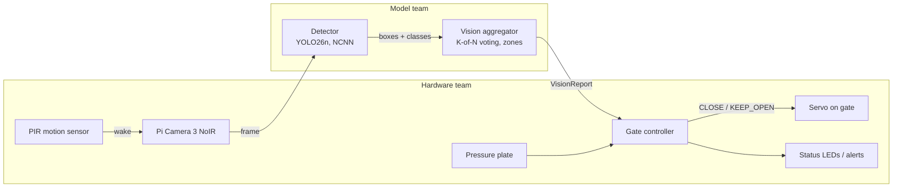

# SCOUT: Smart Cat Observation & Unmanned Trap

An edge-AI add-on for humane live traps used in Trap-Neuter-Return (TNR). A camera and a Raspberry Pi 5 recognize what walks into the trap, and the gate closes only for a cat that is fully inside.

CS 4605 Mobile & Ubiquitous Computing, Fall 2026, Group 29. Mentor: Christine Taylor.
Team: Sudiksha Das and Henry Poulin (model), Keshav Sheth and Sowmiyan Nattamai Vijayakumar (hardware).

Design docs: [SCOUT - Research/Notes](https://docs.google.com/document/d/1BFhBik9DCZgdWnCy8yDcnWfe-6-JuTAZf1hQFuI_Fq8/edit) (CV Model tab: the plan; Code Base tab: how this code maps to it).

## How it works



1. The PIR sensor wakes the system when something moves.
2. The camera captures frames at about 5 fps.
3. The **detector** (fine-tuned YOLO26n) finds animals in each frame: cat, raccoon, opossum, squirrel, dog, other animal, person.
4. The **vision aggregator** smooths those detections over the last 5 frames and reports what it sees: is a cat inside the trap zone (in 3 of the last 5 frames; K and N are in `edge/vision_config.json`)? Is anything in the doorway? Is a non-cat present?
5. The **gate controller** decides whether to close, using the vision report plus the pressure plate and its safety rules.

Everything runs on the Pi, with no Wi-Fi needed.

## Who decides what

| Question | Decided by | Where |
| --- | --- | --- |
| What animal is this, and where is its box? | Model team | `edge/vision.py` `Detector` |
| Is a cat really in the trap zone (not a one-frame glitch)? | Model team | `edge/vision.py` `VisionAggregator` (K, N, thresholds) |
| Is anything in the doorway? Is a non-cat present? | Model team (reports it) | `VisionReport` |
| Where the trap and doorway zones are in the image | Both, once the camera is mounted | `edge/vision_config.json` |
| Should the gate close now? | Hardware team | `edge/gate.py` `GateController` |
| Pressure plate, cooldown after a non-cat, stay closed until reset, fault handling | Hardware team | `edge/gate.py` |
| Servo, LEDs, PIR wiring, power, alerts | Hardware team | hardware hooks in `edge/run_trap.py` |

The model team **reports observations**; the hardware team **decides actions**. `gate.py` is a reference version written so both sides can test today; the hardware team owns and can change it.

## The interface

```python
from edge.vision import Detector, VisionAggregator
from edge.gate import GateController, Command

detector = Detector("best_ncnn_model", imgsz=416)
vision = VisionAggregator.from_config()       # edge/vision_config.json
gate = GateController(require_plate=False)
gate.arm()

report = vision.update(detector.detect(frame))   # model team
status = gate.tick(report, plate_pressed=False)  # hardware team
if status.command == Command.CLOSE:
    close_gate()
```

`VisionReport` fields: `cat_in_trap`, `cat_confidence`, `cat_hits`, `animal_in_doorway`, `non_cat`, `non_cat_confidence`, `cat_box`, `n_detections`, `timestamp`.

### Test the hardware without a model

`edge/stub.py` feeds fake detections through the real vision and gate code. One token per frame: `c` cat in trap, `d` cat in doorway, `r` raccoon, `o` opossum, `n` nothing, `f` fault, `p` cat + plate pressed.

```bash
python -m edge.stub --script c,c,c,c,c            # closes on frame 3 (3-of-5 vote)
python -m edge.stub --script c,c,r,c,c            # raccoon: cooldown, stays open
python -m edge.stub --script c,c,c,c,p --plate    # closes only when the plate is pressed
python -m edge.stub --interactive
python -m edge.stub --trials 50                   # random staged trials, scored
```

## Repo layout

```
data/                  dataset tools (model team, run on PACE ICE)
  fetch_metadata.py      download LILA metadata JSONs only (~50 MB)
  stats.py               images per species and per class, per dataset
  splits.py              location-based train/val/test -> data/splits.json (commit it)
  build_manifest.py      choose balanced images + boxes -> manifest.jsonl
  make_train_list.py     training list with cat images repeated (E1c, E5) + matching yaml
  build_seen_split.py    "seen locations" test split (new bursts from training cameras)
  add_trap_footage.py    import one labeled session of our trap footage (YOLO export)
  download_images.py     download images, write YOLO labels
  common.py              class list, species -> class mapping
  scout.yaml             Ultralytics dataset config
training/              (model team)
  train_yolo.py          train one experiment (E1, E3, E5 ...)
  eval.py                cat recall, per-species false positives, threshold sweep
  analyze_errors.py      why cats are missed: wrong class / low confidence / not found, by size, night, location
  vote_sim.py            choose the cat cutoff + K-of-N vote at trap level (from a sweep, or on real clips)
  train_classifier.py    E2: MobileNetV3 cat / not-cat comparison
  slurm/                 PACE ICE jobs: setup_env.sh, smoke_test, data, train, train_pace, eval_pace
edge/                  code that runs on the Pi
  vision.py              Detector + VisionAggregator + VisionReport (model team)
  vision_config.json     N, K, thresholds, trap/doorway zones
  gate.py                GateController (hardware team)
  run_trap.py            main loop + hardware hooks (PIR, plate, servo)
  stub.py                fake detections for hardware testing
  demo.py                laptop prototype: live boxes, zones, report, simulated gate; records frames
  draw_zones.py          click the trap / doorway zones on a frame -> vision_config.json
  bench.py               per-stage latency on the Pi
tests/                 python -m pytest tests
results/               one folder per experiment (metrics kept, weights git-ignored)
```

## Getting started

### Model team, on PACE ICE

```bash
git clone https://github.com/sudikshadas1/scout.git && cd scout
bash training/slurm/setup_env.sh                 # conda env "scout"
sbatch training/slurm/smoke_test.sbatch          # proves the GPU works
export DATA=~/scratch/scout_data
python data/fetch_metadata.py --out $DATA
python data/stats.py --data $DATA                # real species counts
python data/splits.py --data $DATA               # then commit data/splits.json
sbatch training/slurm/data.sbatch                # manifest + image download
python training/eval.py --model yolo26n.pt --data $DATA --split val --n 500 --name E0
sbatch training/slurm/train.sbatch E1
```

### Hardware team, on the Pi 5

```bash
python3 -m venv --system-site-packages .venv && source .venv/bin/activate   # keeps picamera2
pip install -r requirements-pi.txt
python -m edge.stub --interactive
python -m edge.bench --model yolo26n.pt --export ncnn --imgsz 416 --runs 200
python -m edge.run_trap --model yolo26n_ncnn_model
```

## Current CV results (Oct 22)

| Run | Cat recall @0.05 | Cat recall @0.25 | Non-cat FPR @0.25 | Notes |
| --- | --- | --- | --- | --- |
| E0 stock YOLO26n | 4.3% | | 2.1% | no training |
| E1 fine-tuned, 24 epochs | 63.5% | 54.8% | 2.1% | target is 75% recall, <=25% FPR |

False positives have a lot of room (2% vs a 25% budget), so the next runs trade some of it for recall.

### Next CV runs (on PACE)

```bash
cd ~/scout && git fetch && git checkout cv/recall-analysis-demo && git pull
# 1. Why are cats missed? eval + failure breakdown + contact sheets + cutoff/vote estimate for E1
sbatch training/slurm/eval_pace.sbatch E1_full
# 2. Recall experiments, in parallel (each changes one thing vs E1)
sbatch -J scout-E1b training/slurm/train_pace.sbatch E1b --epochs 80 --patience 25
python data/make_train_list.py --data ~/scratch/scout_data --cat-repeat 2
sbatch -J scout-E1c training/slurm/train_pace.sbatch E1c --epochs 80 --patience 25 \
       --data-yaml ~/scratch/scout_data/scout_cat2x.yaml
# 3. Seen-location score (plan section 7) and the E2 classifier comparison
sbatch training/slurm/seen.sbatch E1_full
sbatch training/slurm/e2.sbatch
# 4. When E1b / E1c finish
sbatch training/slurm/eval_pace.sbatch E1b && sbatch training/slurm/eval_pace.sbatch E1c
```

E1b = train longer (E1 stopped at 24 epochs). E1c = E1b plus every cat image shown twice per epoch.
Read `results/<run>_analysis/summary.json` first: `recall_by_size.large` is the number closest to our
close-range trap camera.

**Cutoff and vote (changed Oct 24).** `training/vote_sim.py` showed the old settings (cat cutoff 0.5,
4-of-5 vote) would let the trap report only about 9% of cats, even though single frames catch more. The config
is now cutoff 0.15 with a 3-of-5 vote (estimated 68% trap recall, ~0.01% false positives, assuming independent
frames). Re-check it on real clips with `vote_sim.py clips` after the footage pilot.

### Footage pilot and our own trap footage

```bash
# record one staged trial per folder, named by what is in it (cat_, raccoon_, opossum_, empty_ ...)
python -m edge.demo --model yolo26n.pt --source 0 --save-dir pilot/clips/cat_01      # press r to record
python -m edge.demo --model yolo26n.pt --picam --headless --record --save-dir pilot/clips/empty_01  # Pi
# measure trap-level recall on those clips for every cutoff x vote setting
python training/vote_sim.py clips --model best.pt --clips pilot/clips --full-frame
# after labeling a session (YOLO export from Roboflow / CVAT / Label Studio)
python data/add_trap_footage.py --data ~/scratch/scout_data --export session1_yolo --session s1_day --split train
python data/add_trap_footage.py --data ~/scratch/scout_data --export session4_yolo --session s4_dark --split test
# E5: public data + our footage (repeated 3x), then the real pass/fail test on held-out trap sessions
python data/make_train_list.py --data ~/scratch/scout_data --cat-repeat 2 \
       --extra-dir ~/scratch/scout_data/trap/yolo/images/train --extra-repeat 3 --tag e5
sbatch -J scout-E5 training/slurm/train_pace.sbatch E5 --weights results/E1c/weights/best.pt --epochs 40 \
       --data-yaml ~/scratch/scout_data/scout_e5.yaml
python training/eval.py --model results/E5/weights/best.pt --data ~/scratch/scout_data/trap --split test --name E5_trap
# once the camera is mounted: draw the trap and doorway zones on a real frame
python -m edge.draw_zones --image pilot/clips/empty_01/<frame>.jpg
```

### Laptop demo

```bash
python -m edge.demo --model results/E1_full/weights/best.pt --source 0                  # webcam
python -m edge.demo --model best.pt --source demo_pics/ --out demo_out/                 # folder, headless
```

## Project phases

The project runs in phases, each ending at a class checkpoint. **We are in Phase 1.** Recording our own trap footage starts early, because a model trained on trail cameras (far away) may fail on our camera (inches from the animal). This is the biggest risk. Details: CV Model tab, sections 10 and 13.

| Phase | Dates | Goal | Finish line |
| --- | --- | --- | --- |
| **1. Get set up** | Now to Oct 23 | Data ready, baseline numbers, first look up close | **CP1:** data split; E0 baseline; footage pilot done; Pi speed number; gate closes from the stub |
| 2a. First recording round + public data | Oct 26 to Nov 1 | Our own labeled trap pictures; first trained models | About 750 labeled trap pictures; E1 to E3 results |
| 2b. Fine-tune, then fix what fails | Nov 2 to Nov 13 | Trained model on the Pi in the real trap | **CP2:** camera to servo end to end on the bench |
| 3. Test and freeze | Nov 16 to Nov 24 | Final numbers and a frozen model | **CP3:** final test results; 50+ staged trials |
| 4. Demo | Nov 30 to Dec 8 | Show it working | **Demo Day:** live labeling of never-seen pictures; gate acts correctly |

### Phase 1 checklist

Done:
- [x] CV plan, model/hardware split and interface agreed
- [x] Base code written and tested (17 tests pass)
- [x] GitHub repo created and base code pushed

To do:
- [ ] Add all team members as collaborators
- [x] PACE ICE setup + test job: `bash training/slurm/setup_env.sh`, then `sbatch training/slurm/smoke_test.sbatch`
- [x] Download the labels and count pictures per animal: `fetch_metadata.py`, then `stats.py`
- [x] Split by camera location and commit `data/splits.json`: `splits.py`
- [x] Download the pictures onto PACE: `sbatch training/slurm/data.sbatch`
- [x] E0 baseline (stock model, no training): `python training/eval.py --model yolo26n.pt --data $DATA --split val --n 500 --name E0`
- [ ] Footage pilot: mount one camera in the real trap, take 50 to 100 pictures (stuffed cat, tablet photo, empty trap), and run the stock model on them
- [x] Laptop prototype: webcam, then model, then boxes and the report on screen (`python -m edge.demo`)
- [ ] Pi 5 + camera speed test: `python -m edge.bench`
- [ ] Hardware team closes the servo from `python -m edge.stub` (CP1 depends on this)
- [ ] Decide the camera position, buy infrared lights for night, and decide whether the pressure plate is in

### Making sure the model learns cats, not backgrounds

Test pictures always come from camera locations the model never trained on (`splits.py`), about 10% of training pictures are empty, and near-identical burst photos are limited (`build_manifest.py`). In our own trap footage, every session includes cats, non-cats and the empty trap, so "inside the trap" never means "cat". Details: CV Model tab, section 7.

### Code status

- **Done and tested:** vision/gate interface, hardware stub, tests (17 pass).
- **Written, needs real data:** data pipeline (tested on fake data), training and evaluation scripts.
- **Written, tested on a laptop:** Pi benchmark and main loop.
- **Written, smoke-tested on a laptop:** laptop demo/recorder (`edge/demo.py`), miss analysis (`training/analyze_errors.py`), cat oversampling (`data/make_train_list.py`), cutoff/vote chooser (`training/vote_sim.py`), seen-location split (`data/build_seen_split.py`), E2 MobileNetV3 comparison (`training/train_classifier.py`), trap-footage import (`data/add_trap_footage.py`), zone drawing (`edge/draw_zones.py`).
- **Still to write:** black-and-white training data (E4), second-camera support.
- **Placeholders:** trap and doorway areas in `edge/vision_config.json`, until the camera is mounted.

Every file starts with a short header: what it does, its purpose, its status, and what still needs to be added or changed in later phases. Read that first before editing a file.

## Later: ear-tip detection

Recognizing already-neutered (ear-tipped) cats is a later goal, after the cat detector works end to end.
