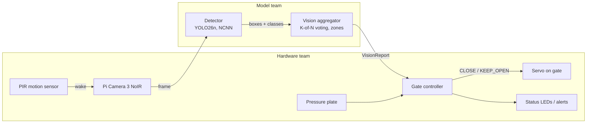

# SCOUT: Smart Cat Observation & Unmanned Trap

An edge-AI add-on for humane live traps used in Trap-Neuter-Return (TNR). A camera and a Raspberry Pi 5 recognize what walks into the trap, and the gate closes only for a cat that is fully inside. Everything runs on the Pi, with no Wi-Fi needed.

CS 4605 Mobile & Ubiquitous Computing, Fall 2026, Group 29. Mentor: Christine Taylor.
Team: Sudiksha Das and Henry Poulin (model), Keshav Sheth and Sowmiyan Nattamai Vijayakumar (hardware).

Design docs: [SCOUT - Research/Notes](https://docs.google.com/document/d/1BFhBik9DCZgdWnCy8yDcnWfe-6-JuTAZf1hQFuI_Fq8/edit). The **CV Model** tab is the plan, the **Code Base Guide** tab maps this code to it, the **CV Team - Next Steps** tab is the step-by-step runbook, and the **High Level Plan** tab has the dated status.

**How we evaluate** (plan section 12). No live animals are used this semester; every trial in our trap is staged with props. So the evaluation has two parts:

1. **Model accuracy, on real animals:** at least 75% of cats caught and no more than 25% of other animals called cats, on held-out public camera-trap pictures from camera locations the model never trained on.
2. **Staged trap trials, with props:** stuffed or printed animals and tablet photos in our trap. The gate closes for cat props and stays open for non-cat props, decides in under 5 seconds, and never reports "cat in trap" while the cat is in the doorway.

Props are not real animals, so prop footage is used to check the camera angle, lighting, zones, vote and gate, not to report accuracy.

## Status (Oct 30)

- **Model:** E1b (YOLO26n fine-tuned on Caltech Camera Traps + ENA24, 80 epochs) is the current model. On new camera locations it catches 73.1% of cats with 9.9% false positives per picture (cutoff 0.05), and 71.2% / 6.5% at the trap's cutoff of 0.15. With the trap's 3-of-5 vote, the estimate is about 85% of cats caught at the trap level.
- **Hardware:** the tabletop prototype is built. Next: program the Pi, mount everything on the trap, and connect the servo and pressure plate to `edge/run_trap.py`.

## How it works



1. The PIR sensor wakes the system when something moves.
2. The camera captures frames at about 5 fps.
3. The **detector** finds animals in each frame: cat, raccoon, opossum, squirrel, dog, other animal, person.
4. The **vision aggregator** reports what it sees. A cat counts as "in the trap" only when it is inside the trap zone in 3 of the last 5 frames. It also reports anything in the doorway and any non-cat. If one animal gets two different labels on the same box, only the clearly stronger label counts.
5. The **gate controller** decides whether to close, using the vision report, the pressure plate and its safety rules (non-cat cooldown, doorway check, fault handling).

The vote, cutoffs and zones live in `edge/vision_config.json`.

### Who decides what

| Question | Decided by | Where |
| --- | --- | --- |
| What animal is this, and where is its box? | Model team | `edge/vision.py` `Detector` |
| Is a cat really in the trap zone (not a one-frame glitch)? | Model team | `edge/vision.py` `VisionAggregator` |
| Is anything in the doorway? Is a non-cat present? | Model team (reports it) | `VisionReport` |
| Where the trap and doorway zones are in the image | Both, once the camera is mounted | `edge/vision_config.json`, drawn with `edge/draw_zones.py` |
| Should the gate close now? | Hardware team | `edge/gate.py` `GateController` |
| Pressure plate, cooldown after a non-cat, stay closed until reset, faults | Hardware team | `edge/gate.py` |
| Servo, LEDs, PIR wiring, power, alerts | Hardware team | hardware hooks in `edge/run_trap.py` |

The model team **reports observations**; the hardware team **decides actions**. `gate.py` is a reference version so both teams can test now; the hardware team owns it and can change it.

### The interface

```python
from edge.vision import Detector, VisionAggregator
from edge.gate import GateController, Command

detector = Detector("best_ncnn_model", imgsz=416)
vision = VisionAggregator.from_config()       # edge/vision_config.json
gate = GateController(require_plate=True)    # gate decision: cat in trap + plate pressed
gate.arm()

report = vision.update(detector.detect(frame))   # model team
status = gate.tick(report, plate_pressed=plate_pressed())  # hardware team
if status.command == Command.CLOSE:
    close_gate()
```

`VisionReport` fields: `cat_in_trap`, `cat_confidence`, `cat_hits`, `animal_in_doorway`, `non_cat`, `non_cat_confidence`, `cat_box`, `n_detections`, `timestamp`.

### Test the hardware without a model

`edge/stub.py` feeds fake detections through the real vision and gate code. One token per frame: `c` cat in trap, `d` cat in doorway, `r` raccoon, `o` opossum, `n` nothing, `f` fault, `p` cat + plate pressed.

```bash
python -m edge.stub --script c,c,c,c,c            # closes on frame 3 (3-of-5 vote)
python -m edge.stub --script c,c,r,c,c            # raccoon: cooldown, stays open
python -m edge.stub --script c,c,c,c,p --plate    # closes only when the plate is pressed
python -m edge.stub --interactive
python -m edge.stub --trials 50                   # random staged trials, scored
```

## Code map

[](https://gitdiagram.com/sudikshadas1/scout?utm_source=readme&utm_medium=picture)

Generated automatically by [gitdiagram](https://gitdiagram.com/sudikshadas1/scout) from the `main` branch, so it can lag behind new files. The flowchart above is the exact runtime flow; the list below is the complete file list.

```
data/                    dataset tools (model team, run on PACE ICE)
  common.py                class list, species -> class mapping
  fetch_metadata.py        download LILA metadata JSONs only (~50 MB)
  stats.py                 images per species and per class, per dataset
  splits.py                location-based train/val/test -> data/splits.json (committed, never change)
  build_manifest.py        choose balanced images + boxes -> manifest.jsonl
  download_images.py       download images, write YOLO labels
  validate_dataset.py      check every YOLO label file
  build_seen_split.py      "seen locations" test split (new bursts from training cameras)
  make_train_list.py       training list with cat images repeated (E1c, E5) + matching yaml
  add_trap_footage.py      import one labeled session of staged trap footage (props, YOLO export)
  video_to_frames.py       real-animal videos -> clip folders for vote_sim.py + a pre-labeled frame pool
  scout.yaml               Ultralytics dataset config
training/                training and evaluation (model team, PACE ICE)
  train_yolo.py            train one detector experiment (E1b, E1c, E5 ...)
  eval.py                  cat recall, per-species false positives, threshold sweep
  analyze_errors.py        why cats are missed, by size, day/night, dataset and location
  vote_sim.py              choose the cat cutoff + K-of-N vote at trap level; replays the real gate on clips
  train_classifier.py      E2: MobileNetV3 cat / not-cat comparison
  slurm/                   PACE jobs (see below)
edge/                    code that runs on the Pi
  vision.py                Detector + VisionAggregator + VisionReport (model team)
  vision_config.json       N, K, cutoffs, trap/doorway zones
  gate.py                  GateController (hardware team)
  run_trap.py              main loop + hardware hooks (PIR, plate, servo)
  stub.py                  fake detections for hardware testing
  bench.py                 per-stage latency on the Pi
  demo.py                  laptop prototype: live boxes, zones, report, simulated gate; records frames
  draw_zones.py            click the trap / doorway zones on a frame -> vision_config.json
tests/                   python -m pytest tests
results/                 one folder per experiment (metrics kept, weights git-ignored)
```

PACE jobs in `training/slurm/`:

| Job | What it runs |
| --- | --- |
| `setup_env.sh`, `smoke_test.sbatch` | one-time conda setup, GPU check |
| `data.sbatch` | metadata, manifest and image download |
| `e0.sbatch`, `e1_*.sbatch` | the E0 and E1 runs as they were done (yolo CLI) |
| `train_pace.sbatch <name> [args]` | any new detector run through `train_yolo.py` |
| `eval_pace.sbatch <name>` | eval + miss analysis + cutoff/vote estimate for one run |
| `seen.sbatch <name>` | seen-location score |
| `e2.sbatch` | E2 classifier |

The E1 jobs and `train_pace.sbatch` read `data/scout_pace.yaml`, a copy of `data/scout.yaml` with the absolute scratch path. It is only on PACE (`~/scout/data/`), not in git.

## Getting started

### Model team, on PACE ICE

First-time setup (already done once; repeat only on a new account):

```bash
git clone https://github.com/sudikshadas1/scout.git && cd scout
bash training/slurm/setup_env.sh                 # conda env "scout"
sbatch training/slurm/smoke_test.sbatch          # proves the GPU works
export DATA=~/scratch/scout_data
python data/fetch_metadata.py --out $DATA
python data/stats.py --data $DATA
python data/splits.py --data $DATA               # data/splits.json is already committed: don't rerun
sbatch training/slurm/data.sbatch                # manifest + image download
python data/validate_dataset.py
```

### Hardware team, on the Pi 5

```bash
python3 -m venv --system-site-packages .venv && source .venv/bin/activate   # keeps picamera2
pip install -r requirements-pi.txt
python -m edge.stub --interactive
python -m edge.bench --model best.pt --export ncnn --imgsz 416 --runs 200   # best.pt = E1b
python -m edge.run_trap --model best_ncnn_model --plate
```

## CV results

Validation set: the same 500 pictures (208 cats, 292 non-cats) from camera locations the model never trained on. Recall is the share of cats called "cat"; FPR is the share of non-cats called "cat", per picture. The trap uses cutoff 0.15.

| Run | What changed | Recall @0.05 | FPR @0.05 | Recall @0.15 | FPR @0.15 |
| --- | --- | --- | --- | --- | --- |
| E0 | stock YOLO26n, no training | 5.3% | 5.1% | 4.8% | 2.7% |
| E1 | fine-tuned on Caltech + ENA24, 24 epochs | 63.5% | 4.5% | 59.6% | 2.4% |
| **E1b** | **E1 settings, trained longer (80 epochs)** | **73.1%** | **9.9%** | **71.2%** | **6.5%** |
| E1c | E1b + cat pictures shown twice | 70.7% | 6.8% | 69.7% | 5.8% |
| E2 | MobileNetV3 cat / not-cat classifier (comparison only) | 27.9% | 6.2% | 22.6% | 3.8% |

The plan's E3 ("add ENA24") is already part of E1. Files: `results/<run>_eval/` (scores and cutoff sweep) and `results/<run>_analysis/` (why cats are missed).

### What the results show (Oct 30)

- **E1b is the model to build on.** Showing cat pictures twice (E1c) did not beat it, and the classifier (E2) is far behind and can't say where the cat is.
- **Most misses are wrong labels, not missed animals.** At cutoff 0.25, E1b misses 64 of 208 cats (E1: 94): 47 called another animal, 14 not found, 3 found with low cat confidence. The missed cats were called other animal 18 times, raccoon 11, opossum 10, dog 5 and squirrel 3.
- **"Other animal" is the main confusion both ways.** It is also the class most often called a cat (12.9% of other-animal pictures at 0.25; raccoon 4.4%, opossum 3.0%). This class holds bobcats, coyotes and similar animals; checking which species are involved is the next step.
- **Small and daytime cats are hardest.** E1b catches 89% of medium cats, 69% of small and 50% of tiny ones; our trap camera sees cats up close. 186 of the 208 cats are night (black-and-white) pictures, caught 74% of the time; the 22 daytime cats are caught only 6 times by both E1 and E1b. That is a small sample, but worth checking with prop footage.
- **Seen-location score:** no unseen cat pictures were left at the training cameras, so seen vs new recall could not be compared. On 250 non-cat pictures from training cameras, E1 called 0.4% cats.

### Trap settings

**Cutoff and vote.** The trap acts on a vote across frames, not on one picture. `training/vote_sim.py` estimates trap-level results from each run's cutoff sweep (`results/<run>_eval/vote_sweep.csv`). For E1b, the current config (cutoff 0.15, 3-of-5 vote) gives an estimated 85.2% of cats caught and 0.25% false triggers; the old config (0.5, 4-of-5) would give 37.3%. The estimate assumes frames are independent, so it must be re-measured on staged clips with `vote_sim.py clips`, which also replays the real gate.

**One animal, one label.** If the model labels the same cat "cat" and also "opossum" in one frame, the weaker label is dropped, but only when the stronger one is at least 0.1 more confident. Close calls keep both, so a possible non-cat still holds the gate open (`same_animal_iou`, `same_animal_margin` in `vision_config.json`). Before this rule, such a cat put the gate into its 10-second non-cat cooldown.

## Next CV runs

Step-by-step with explanations: the **CV Team - Next Steps** tab.

```bash
# get the latest code on PACE
cd ~/scout && git checkout main && git pull

# score a finished run: eval + miss analysis + cutoff/vote estimate
sbatch training/slurm/eval_pace.sbatch E1b
# E5 (needs labeled prop footage, see below), starting from E1b
sbatch -J scout-E5 training/slurm/train_pace.sbatch E5 --weights results/E1b/weights/best.pt --epochs 40 \
       --data-yaml ~/scratch/scout_data/scout_e5.yaml
sbatch training/slurm/eval_pace.sbatch E5      # re-score on the real-animal public pictures
```

What to read: `results/<run>_eval/metrics.json` (`fpr_by_species`: which animals are called cats), `results/<run>_analysis/summary.json` (`missed_cats_called`, `recall_by_size`, `recall_by_night`) and `results/<run>_eval/vote_sweep.csv` (trap-level estimate).

### Staged trap footage (props, no live animals)

```bash
# record one staged trial per folder, named by what is in it (cat_, raccoon_, opossum_, empty_ ...)
python -m edge.demo --model results/E1b/weights/best.pt --source 0 --save-dir pilot/clips/cat_01      # press r to record
python -m edge.demo --model best_ncnn_model --picam --headless --record --save-dir pilot/clips/empty_01  # on the Pi
# trap-level recall and gate behaviour on those clips, for every cutoff x vote setting
python training/vote_sim.py clips --model best.pt --clips pilot/clips --full-frame
# after labeling a session (YOLO export from Roboflow / CVAT / Label Studio); keep 1-2 whole sessions as test
python data/add_trap_footage.py --data ~/scratch/scout_data --export session1_yolo --session s1_day --split train
python data/add_trap_footage.py --data ~/scratch/scout_data --export session4_yolo --session s4_dark --split test
# E5: public data + our prop footage (repeated 3x), then the staged test on held-out trap sessions
python data/make_train_list.py --data ~/scratch/scout_data --cat-repeat 2 \
       --extra-dir ~/scratch/scout_data/trap/yolo/images/train --extra-repeat 3 --tag e5
sbatch -J scout-E5 training/slurm/train_pace.sbatch E5 --weights results/E1b/weights/best.pt --epochs 40 \
       --data-yaml ~/scratch/scout_data/scout_e5.yaml
python training/eval.py --model results/E5/weights/best.pt --data ~/scratch/scout_data/trap --split test --name E5_trap
# once the camera is mounted: draw the trap and doorway zones on a real frame, then commit vision_config.json
python -m edge.draw_zones --image pilot/clips/empty_01/<frame>.jpg
```

### Real-animal videos (Christine's trail camera)

```bash
# videos.csv: one line per video, "video,animal" (cat, raccoon, opossum, ..., empty)
# 1. test the vote and gate on real animals: one 5 fps clip folder per video
python data/video_to_frames.py --videos ~/christine_videos --labels videos.csv --clips-out real/clips
python training/vote_sim.py clips --model results/E1b/weights/best.pt --clips real/clips --full-frame
# 2. labeling pool: one frame per second, pre-labeled by E1b so labeling is correcting
python data/video_to_frames.py --videos ~/christine_videos --labels videos.csv \
       --pool-out real/pool --pool-every 1 --prelabel results/E1b/weights/best.pt
```

Keep whole videos in one split: frames from one video are near-identical.

### Laptop demo

```bash
python -m edge.demo --model results/E1b/weights/best.pt --source 0          # webcam
python -m edge.demo --model best.pt --source demo_pics/ --out demo_out/    # picture folder, no window
```

Keys: `q` quit, `space` pause, `s` save a frame, `r` start/stop recording, `a` re-arm the gate, `z` toggle zones.

## Project phases

Each phase ends at a class checkpoint. The model freeze is Nov 16 because Sudiksha is away Nov 17 to 27. No live animals: all trap trials are staged with props.

| Phase | Dates | Finish line | Status |
| --- | --- | --- | --- |
| 1. Get set up | to Oct 23 (CP1) | data split; E0; laptop prototype | done; footage pilot, Pi speed and servo moved to 2b |
| 2a. Public data | to Oct 31 | E1, E1b, E1c, E2 results | done; prop recording moved to 2b (camera not on the trap yet) |
| 2b. Fine-tune and fix what fails | Nov 2 to 13 (CP2) | E5 on prop footage; camera to servo end to end on the bench | |
| 3. Test and freeze | freeze by Nov 16; CP3 Nov 24 | final numbers; 50+ staged prop trials | |
| 4. Demo | Dec 2 to 8 | live labeling of new pictures; gate acts correctly | |

### Open items

- [ ] Pi set up with the camera, servo and plate (`apply()`, `plate_pressed()` in `edge/run_trap.py`)
- [ ] Pi speed test with E1b: `python -m edge.bench --model best.pt --export ncnn --imgsz 416`
- [ ] Camera position in the trap, then draw the zones (`python -m edge.draw_zones`)
- [ ] Infrared light for night pictures
- [ ] Footage pilot and labeling round 1 (pick a labeling tool; Roboflow suggested)
- [ ] Check which "other animal" species are confused with cats
- [ ] Run Christine's videos through `data/video_to_frames.py` and `vote_sim.py clips`

### Making sure the model learns cats, not backgrounds

Test pictures always come from camera locations the model never trained on (`splits.py`), about 10% of training pictures are empty, and near-identical burst photos are limited (`build_manifest.py`). The seen-location score (`build_seen_split.py`) measures how much the model still relies on backgrounds. In our staged trap footage, every session includes cat props, non-cat props and the empty trap, so "inside the trap" never means "cat". Because props can look different from real animals, E5 (trained with prop footage) is always also re-scored on the real-animal public test pictures, so it can't trade real accuracy for prop accuracy. Details: CV Model tab, section 7.

### Code status

- **Run on real data:** data pipeline; E0, E1, E1b, E1c and E2 training and evaluation; miss analysis; cutoff/vote estimate; seen-location split.
- **Written and tested, waiting on prop footage:** trap-footage import, E5 training list, `vote_sim.py clips`.
- **Written and tested on a laptop:** vision/gate interface, hardware stub, laptop demo and recorder, zone drawing, Pi benchmark and main loop (not yet on the Pi).
- **Written and tested, waiting on the videos:** `data/video_to_frames.py` for Christine's real-animal videos.
- **Still to write:** black-and-white training data (E4), second-camera support.
- **Placeholders:** the trap and doorway zones in `edge/vision_config.json`, until the camera is mounted.

Every file starts with a short header: what it does, its status, and what still needs to change. Read it before editing.

## Later: ear-tip detection

Recognizing already-neutered (ear-tipped) cats is a later goal, after the cat detector works end to end.
