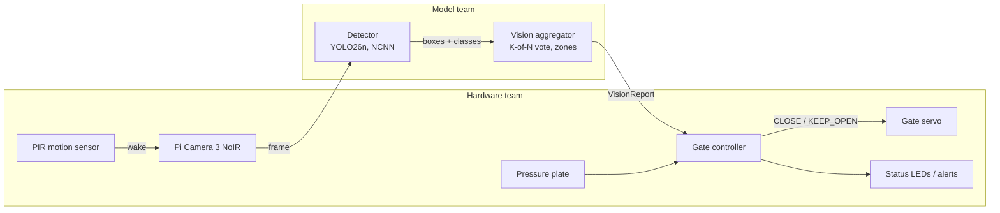

# SCOUT: Smart Cat Observation & Unmanned Trap

An edge-AI add-on for humane live traps used in Trap-Neuter-Return (TNR). A camera and a Raspberry Pi 5 recognize what enters the trap, and the gate closes only for a cat that is fully inside. Everything runs on the Pi, with no Wi-Fi needed.

**CS 4605 Mobile & Ubiquitous Computing · Fall 2026 · Group 29**
Mentor: Christine Taylor · Model team: Sudiksha Das, Henry Poulin · Hardware team: Keshav Sheth, Sowmiyan Nattamai Vijayakumar

Design docs: [SCOUT - Research/Notes](https://docs.google.com/document/d/1BFhBik9DCZgdWnCy8yDcnWfe-6-JuTAZf1hQFuI_Fq8/edit) (CV Model, Code Base Guide, CV Team - Next Steps, High Level Plan tabs)

### Success criteria

No live animals are trapped this semester.

| Part | Tested on | Target |
| --- | --- | --- |
| Model accuracy | Held-out public camera-trap pictures from unseen locations | ≥ 75% of cats caught, ≤ 25% of non-cats called cats |
| Trap trials | Staged with props (stuffed animals, tablet photos) | Correct gate action, decision < 5 s, never closes on the doorway |

Prop footage checks the camera, zones, vote and gate. It is not used to report accuracy.

## Status (Oct 30)

- **Model:** best run is **E1b**, with **69.2%** cat recall and **4.8%** false positives. The model finds 92% of cats but mislabels most of the ones it misses.
- **Hardware:** stub, gate logic and Pi benchmark are written. Still waiting on the trap, the camera mount, the Pi with a camera, and an IR light.

## How it works



1. **Wake:** the PIR sensor detects motion and the camera starts at about 5 fps.
2. **Detect:** YOLO labels each animal as cat, raccoon, opossum, squirrel, dog, other animal or person.
3. **Vote:** a cat counts as "in trap" only if it is in the trap zone in 3 of the last 5 frames. If one box gets two labels, only the clearly stronger one counts.
4. **Decide:** the gate controller combines the vision report, the pressure plate and its safety rules (non-cat cooldown, doorway check, faults).

Vote, cutoffs and zones are set in `edge/vision_config.json`.

### Who owns what

The model team **reports observations**; the hardware team **decides actions**.

| Decision | Owner | Where |
| --- | --- | --- |
| Animal class and box | Model | `edge/vision.py` `Detector` |
| Cat really in trap? Doorway? Non-cat? | Model | `edge/vision.py` `VisionAggregator` |
| Trap and doorway zones | Both | `edge/vision_config.json` (`edge/draw_zones.py`) |
| Close the gate now? | Hardware | `edge/gate.py` `GateController` |
| Servo, LEDs, PIR, plate, power | Hardware | `edge/run_trap.py` |

### Interface

```python
from edge.vision import Detector, VisionAggregator
from edge.gate import GateController, Command

detector = Detector("best_ncnn_model", imgsz=416)
vision = VisionAggregator.from_config()
gate = GateController(require_plate=False)
gate.arm()

report = vision.update(detector.detect(frame))    # model team
status = gate.tick(report, plate_pressed=False)   # hardware team
if status.command == Command.CLOSE:
    close_gate()
```

`VisionReport` fields: `cat_in_trap`, `cat_confidence`, `cat_hits`, `animal_in_doorway`, `non_cat`, `non_cat_confidence`, `cat_box`, `n_detections`, `timestamp`.

### Test without a model

`edge/stub.py` sends fake detections through the real vision and gate code. Each token is one frame: `c` cat in trap, `d` cat in doorway, `r` raccoon, `o` opossum, `n` nothing, `f` fault, `p` cat with plate pressed.

```bash
python -m edge.stub --script c,c,c,c,c            # closes on frame 3
python -m edge.stub --script c,c,r,c,c            # raccoon -> cooldown, stays open
python -m edge.stub --script c,c,c,c,p --plate    # closes only when plate pressed
python -m edge.stub --interactive
python -m edge.stub --trials 50                   # 50 random scored trials
```

## Code map

```
data/        dataset tools (PACE)
  common.py, fetch_metadata.py, stats.py   class list, LILA metadata, counts
  splits.py, splits.json                   location-based splits (committed, do not change)
  build_manifest.py, download_images.py    balanced image list, YOLO labels
  validate_dataset.py                      label checks
  build_seen_split.py                      seen-location test split
  make_train_list.py                       cat oversampling, extra footage
  add_trap_footage.py                      import labeled prop footage
training/    training and evaluation (PACE)
  train_yolo.py                            train a detector run
  eval.py                                  recall, per-species FPR, threshold sweep
  analyze_errors.py                        why cats are missed
  vote_sim.py                              choose cutoff + K-of-N vote; replay gate on clips
  train_classifier.py                      E2 MobileNetV3 comparison
  slurm/                                   PACE jobs
edge/        runs on the Pi
  vision.py, vision_config.json            detector, aggregator, settings
  gate.py, run_trap.py                     gate controller, main loop + hardware hooks
  stub.py, bench.py                        fake detections, Pi latency
  demo.py, draw_zones.py                   laptop demo/recorder, zone drawing
tests/       python -m pytest tests
results/     one folder per run (metrics kept, weights git-ignored)
```

| PACE job (`training/slurm/`) | Runs |
| --- | --- |
| `setup_env.sh`, `smoke_test.sbatch` | conda setup, GPU check |
| `data.sbatch` | metadata, manifest, image download |
| `e0.sbatch`, `e1_*.sbatch`, `e1b_eval.sbatch`, `e1c_eval.sbatch` | past runs, as run |
| `train_pace.sbatch <name> [args]` | any new detector run |
| `eval_pace.sbatch <name>` | eval + miss analysis + vote estimate |
| `seen.sbatch <name>` | seen-location score |
| `e2.sbatch` | E2 classifier |

Jobs read `data/scout_pace.yaml`, which exists only on PACE (`~/scout/data/`) and is not in git.

## Getting started

**Model team (PACE ICE).** Already set up; repeat only on a new account.

```bash
git clone https://github.com/sudikshadas1/scout.git && cd scout
bash training/slurm/setup_env.sh
sbatch training/slurm/smoke_test.sbatch
export DATA=~/scratch/scout_data
python data/fetch_metadata.py --out $DATA
sbatch training/slurm/data.sbatch
python data/validate_dataset.py
```

**Hardware team (Pi 5).**

```bash
python3 -m venv --system-site-packages .venv && source .venv/bin/activate
pip install -r requirements-pi.txt
python -m edge.stub --interactive
python -m edge.bench --model yolo26n.pt --export ncnn --imgsz 416 --runs 200
python -m edge.run_trap --model yolo26n_ncnn_model
```

## CV results

Validation: 500 pictures (208 cats) from camera locations never used in training.

| Run | Change | Recall @0.05 | Recall @0.25 | FPR @0.25 |
| --- | --- | --- | --- | --- |
| E0 | Stock YOLO26n | 5.3% | 4.3% | 2.1% |
| E1 | Fine-tuned on Caltech + ENA24, 24 epochs | 63.5% | 54.8% | 2.1% |
| **E1b** | **E1, 80 epochs** | **73.1%** | **69.2%** | **4.8%** |
| E1c | E1b + cat images repeated 2× | 70.7% | 68.8% | 5.1% |
| E2 | MobileNetV3 classifier | 27.9% | 18.8% | 3.1% |

**What E1b's misses show:**
- 47 of 64 missed cats were found but given the wrong label (mostly other animal, raccoon or opossum).
- Small and tiny cats are missed most. Our close-range trap camera should mostly see large cats.
- Only 22 cats were in daylight images, so the day/night split isn't conclusive yet.
- Only 2% of the 25% false-positive budget is used, so there's room to trade some of it for recall.

**Settings.**
- The trap acts on a 3-of-5 vote at a 0.15 cutoff, not on single frames. Re-measure this on staged clips with `vote_sim.py clips`.
- If one box gets two labels, the weaker one is dropped only when it trails by at least 0.1 confidence. Close calls keep both, so the gate stays open.

## Next steps

1. Re-run the seen-location split. The current one has 0 cats, so it can't score cat recall.
2. Run `eval_pace.sbatch E1b` to get a trap-level vote estimate for the new best model.
3. Record staged prop footage, label it, and train E5 from E1b.
4. Benchmark on the Pi and close the servo from the stub.

**Staged footage and E5**

```bash
python -m edge.demo --model best.pt --source 0 --save-dir pilot/clips/cat_01      # r to record
python training/vote_sim.py clips --model best.pt --clips pilot/clips --full-frame
python data/add_trap_footage.py --data ~/scratch/scout_data --export session1_yolo --session s1_day --split train
python data/make_train_list.py --data ~/scratch/scout_data --cat-repeat 2 \
       --extra-dir ~/scratch/scout_data/trap/yolo/images/train --extra-repeat 3 --tag e5
sbatch -J scout-E5 training/slurm/train_pace.sbatch E5 --weights results/E1b/weights/best.pt --epochs 40 \
       --data-yaml ~/scratch/scout_data/scout_e5.yaml
python -m edge.draw_zones --image pilot/clips/empty_01/<frame>.jpg               # once camera is mounted
```

**Laptop demo**

```bash
python -m edge.demo --model results/E1b/weights/best.pt --source 0        # webcam
python -m edge.demo --model best.pt --source demo_pics/ --out demo_out/   # folder of pictures
```

Keys: `q` quit · `space` pause · `s` save frame · `r` record · `a` re-arm · `z` zones

## Project phases

| Phase | Dates | Goal | Status |
| --- | --- | --- | --- |
| 1. Setup | to Oct 23 (CP1) | Data split, E0, demo, Pi speed, servo from stub | Data, E0, demo done |
| 2a. Public data + footage | to Oct 31 | E1, E1b, E1c, E2; ~750 labeled prop pictures | Runs done; footage open |
| 2b. Fine-tune | Nov 2 – 13 (CP2) | E5; camera → servo end to end | |
| 3. Test + freeze | freeze Nov 16; CP3 Nov 24 | Final numbers; 50+ staged trials | |
| 4. Demo | Dec 2 – 8 | Live labeling; correct gate action | |

### Open items

- [ ] Add all team members as GitHub collaborators
- [ ] Footage pilot in the real trap (stuffed cat, tablet photos, empty trap)
- [ ] Pi 5 + camera speed test (`python -m edge.bench`)
- [ ] Close the servo from `python -m edge.stub`
- [ ] Camera position, IR light, pressure plate decision
- [ ] Pick a labeling tool and record round 1

### Learning cats, not backgrounds

- Test images always come from unseen camera locations.
- About 10% of training images are empty, and near-duplicate burst photos are limited.
- Every staged session includes cat props, non-cat props and an empty trap.
- E5 is always re-scored on real-animal test pictures.

### Code status

| State | Code |
| --- | --- |
| Run on real data | data pipeline, E0, E1, E1b, E1c, E2, miss analysis |
| Tested on laptop | vision/gate interface, stub, demo, zone tool, Pi benchmark, main loop |
| To write | grayscale training data (E4), second-camera support |
| Placeholder | trap and doorway zones, until the camera is mounted |

Each file starts with a header covering its purpose, status and remaining work.
